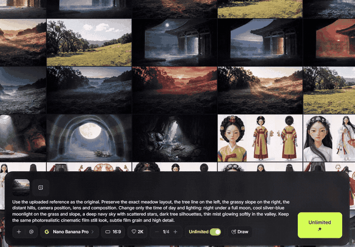
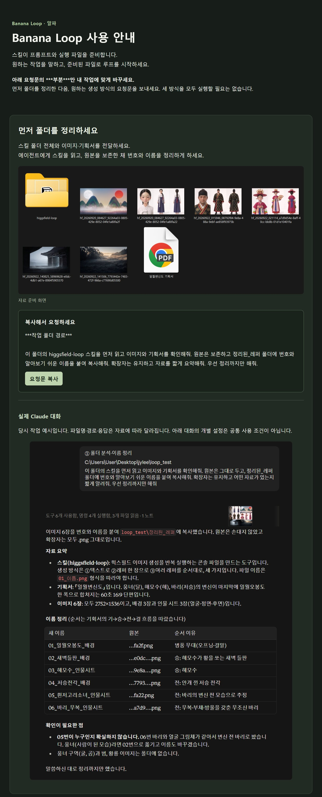
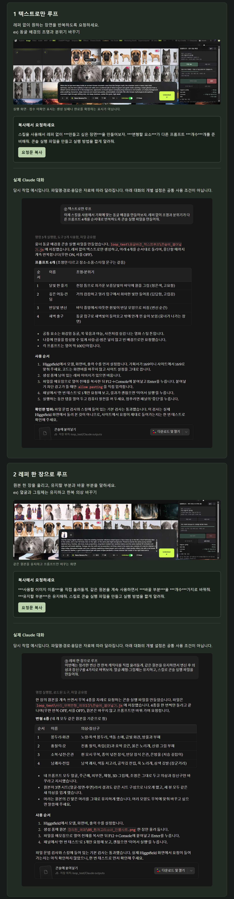
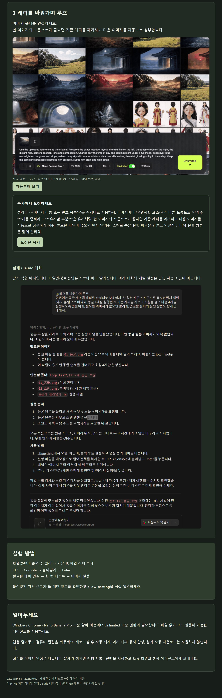

# Banana Loop

<picture>
  <source media="(prefers-color-scheme: dark)" srcset="logo/banana_loop_logo_dark.png">
  
</picture>

An agent skill that repeats image generations on Higgsfield (Nano Banana and other image models).
The agent writes the prompts and packs them into one file, `콘솔에_붙여넣기.js`; you paste that file into the browser console and it runs the batch for you.



*Folder mode: the next reference is uploaded, attached to the form, and its prompts are sent with Unlimited on.*

> Alpha (`0.3.2-alpha.6`). Real submissions were confirmed only on Windows Chrome with Nano Banana Pro.
> It drives the site's own page, so a change to the Higgsfield UI can break it.

## What it does

| Mode | |
|---|---|
| Text only | No reference image; only the prompt changes between runs |
| One reference | Keeps the one original you uploaded on the site and swaps prompts |
| Reference folder | Uploads `01_name.png`, `02_name.png` … in order, runs every prompt prepared for that image, then replaces it with the next one |

The panel has loop, shuffle, a single test run, stop and resume, and a diagnostics export.
Aspect ratio, model and output count are left as they are set on the site.

## Install

Copy this whole folder into your agent's skills folder.

- Claude Code: `~/.claude/skills/banana-loop/`
- Other agents: any agent that can read files and run Python works; have it read `SKILL.md` first.

Needs Python 3.9+, a Higgsfield account and Unlimited access for the model you use. `pip install Pillow` adds a resolution check for reference images.

## Using it

1. Tell the agent what you want and where your material is (a reference folder, cut notes …). [요청_예시.txt](요청_예시.txt) has requests you can copy.
2. Open the `콘솔에_붙여넣기.js` it gives you in Notepad and copy all of it.
3. On the Higgsfield image page, set the model, aspect ratio and output count, open `F12 → Console`, paste and press Enter.
4. Press **한 번 테스트** (single test) in the panel, check the result, then **일괄 시작** (start). For the folder mode press **이미지 폴더 연결** (connect folder) first.

The Korean quick start is [처음_시작하기.txt](처음_시작하기.txt).

### Illustrated guide (Korean)

Step-by-step pages with the request to copy for each mode and the real Claude conversation it came from.
They were made with alpha.5, when the skill folder was still called `higgsfield-loop`; the requests work the same with `banana-loop`.

<details>
<summary>1. Sort the reference folder first</summary>


</details>

<details>
<summary>2. Text only, and one reference</summary>


</details>

<details>
<summary>3. Reference folder, swapped in order</summary>


</details>

## Layout

```
SKILL.md                  rules the agent follows
assets/engine.js          runtime: DomResolver, PromptEditor, ReferenceManager, SubmissionMonitor, BatchController
assets/console-panel.js   the on-page panel
scripts/scan_refs.py      checks and renames a reference folder, writes cuts.json
scripts/build_prompts.py  cuts × axis preset → _prompts.json with no repeated combinations
scripts/build_console.py  builds the single console file with the prompts embedded
scripts/axes/*.json       axis presets: industrial, people, product, space
references/               detailed rules, troubleshooting, release checks
examples/                 sample prompt data
logo/                     icons and wordmarks (made by tools/make_logo.py)
docs/demo.gif             the demo above
docs/guide/               the illustrated Korean guide
tools/make_logo.py        repo upkeep only; the skill never uses it
```

## Working on it

```bash
python scripts/tests/tooling_test.py
```

```bash
node scripts/verify.js assets/engine.js
```

`scripts/tests/*.cjs` are Node.js tests for the engine and a mock browser page. They do not replace a check on the live Higgsfield page.

The logo uses the same ALIENMEOW head as Framing and Griding (`logo/source/alien_head.png`). Rebuild it with `python tools/make_logo.py`, or compare styles with `python tools/make_logo.py --drafts <folder>`.

## Good to know

- "Accepted" means a new queued/generating marker appeared on the site, not that the image finished.
- Keep the tab open and sleep off while it runs. A page refresh does not resume on its own.
- If something fails, save `진행 기록 · 진단` (log · diagnostics) from the panel and show it to the agent.
- Check Higgsfield's terms of service yourself before automating; use at your own risk. This project is not affiliated with Higgsfield.
